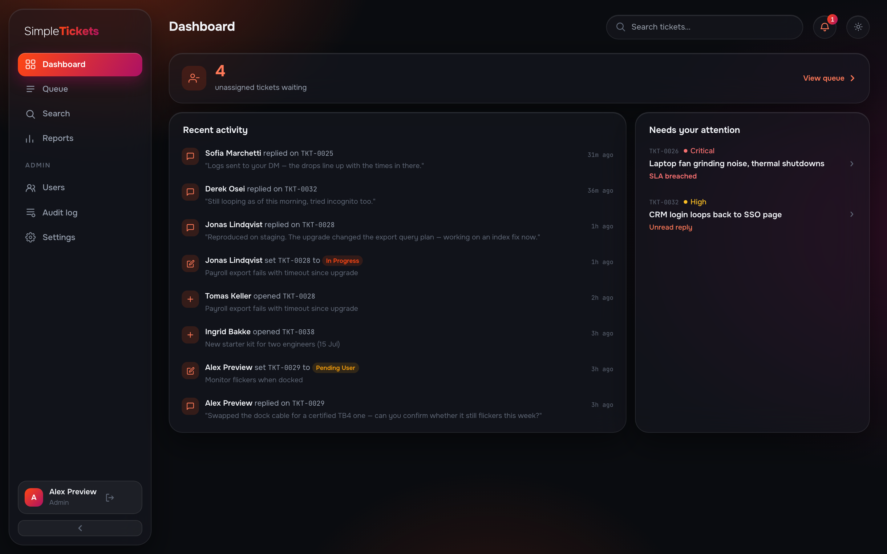
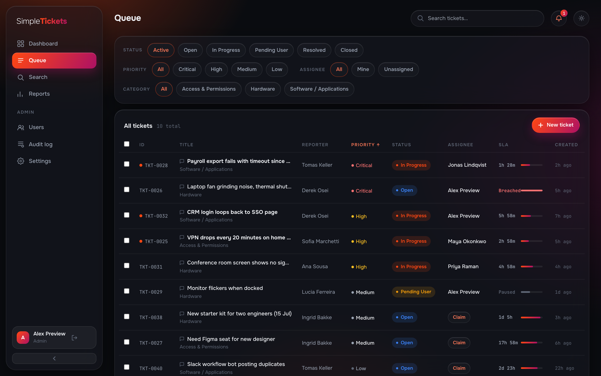
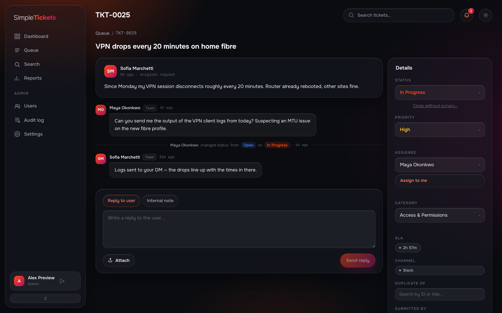

# Simple**Tickets**

A self-hosted, Slack-first helpdesk for small IT teams. People ask for help in
Slack or by email, with no portal account to create; technicians work the queue
in a web UI. One `docker compose up`, no config files.



## Features

- **Slack intake** — DM the bot, react with an emoji, `/ticket`, or a message
  shortcut; replies and files sync both ways in the thread
- **Email channel** — connect a Google Workspace mailbox (e.g. `help@`): new mail
  becomes a ticket and replies go out in the same thread
- **SLAs** — first-response and resolution targets per priority, business hours,
  pausable statuses, breach warnings
- **Queue** — filters, saved views, live SLA meters, bulk actions
- **CSAT, reports and search** — surveys on resolution, team and technician
  reports with CSV export, full-text search
- **Sign in with Google** for staff, with a password break-glass admin
- **Everything in the UI** — users, statuses, categories, SLAs, integrations,
  backup and restore

| | |
|---|---|
|  |  |

## Quick start

```bash
git clone https://github.com/gillesdelhaes/SimpleTickets.git
cd SimpleTickets
docker compose up -d
```

Open **http://localhost:3000**. The setup wizard creates your admin account and
can connect Slack (a copy-paste app manifest; Socket Mode, so no public URL).

For production (TLS, VPN-only hosting, egress allowlist, Google sign-in, the
email mailbox, backups), see **[docs/DEPLOYMENT.md](docs/DEPLOYMENT.md)**.
Plain HTTP on `:3000` is for localhost only.

## Stack

FastAPI · PostgreSQL 16 · SQLModel/Alembic · Slack Bolt · React 18 + TypeScript ·
Vite · Tailwind · TanStack Query. Three containers (db, api, frontend); only the
frontend port is exposed.

## License

MIT — see [LICENSE](LICENSE).
